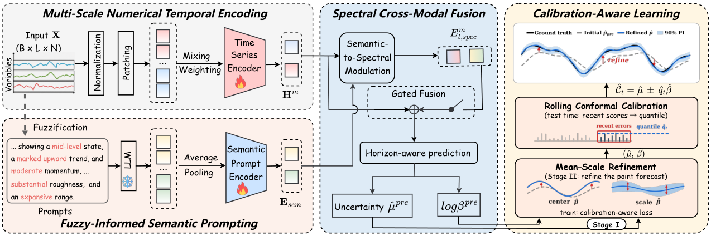

<div align="center">
  <h2><b> FuCAL: Fuzzy Temporal Semantics for Uncertainty-Aware Multivariate Time Series Forecasting </b></h2>
</div>

This repository contains the code of FuCAL for ETTh1, ETTh2, ETTm1, ETTm2, Weather, Electricity (ECL),
Traffic and Solar (prediction lengths 96, 192, 336 and 720).

## Abstract
Multivariate time series forecasting requires predictions that account for both the observed temporal state and estimated forecast reliability. Recent LLM-assisted time series forecasting methods introduce linguistic or semantic representations into time series prediction. However, methods that verbalize temporal dynamics often represent continuously varying states with discrete semantic labels, which can obscure differences in state intensity. Meanwhile, predictive uncertainty is often used only for interval construction rather than to inform point prediction. We propose FuCAL, a unified framework that makes fuzzy temporal semantics and estimated uncertainty active conditions of forecasting rather than merely auxiliary features and outputs. Fuzzy semantic prompts express historical states together with their membership strengths and condition multi-scale numerical representations through spectral cross-modal fusion. The resulting residual-scale estimates then guide bounded refinement of the predictive mean. Rolling normalized conformal calibration constructs adaptive prediction intervals from recent observed residual scores, for which we establish a finite-sample coverage lower bound under local concentration and bounded drift assumptions. Experiments across diverse real-world benchmarks demonstrate that FuCAL achieves strong forecasting accuracy and sharper prediction intervals than the evaluated baselines while maintaining empirical coverage close to the nominal level.

<p align="center">
  
</p>

## Dependencies

* Python 3.10
* PyTorch 2.0.0
* CUDA 11.7
* transformers 4.46.3

```bash
> conda env create -f env_ubuntu.yaml
> conda activate fucal
```

The reported runs used one NVIDIA GPU with 46 GB of memory (batch size 1024, FP32).

## Datasets
The datasets can be obtained from [TimesNet](https://drive.google.com/drive/folders/13Cg1KYOlzM5C7K8gK8NfC-F3EYxkM3D2). Place the files as

```
dataset/ETTh1.csv  dataset/ETTh2.csv  dataset/ETTm1.csv  dataset/ETTm2.csv
dataset/Weather.csv  dataset/ECL.csv  dataset/Traffic.csv  dataset/Solar.csv
```

## Usages
Run all commands from the repository root.

* ### Fuzzy prompt embedding storage

```bash
bash scripts/Store_ETT.sh        # ETTh1, ETTh2
bash scripts/Store_{data_name}.sh  # ETTm, Weather, ECL, Traffic, Solar
```

* ### Train and inference

```bash
bash scripts/{data_name}.sh
```

Test MSE and MAE are written to `./Results/<data>/i<seq_len>_o<pred_len>/results.csv`.
